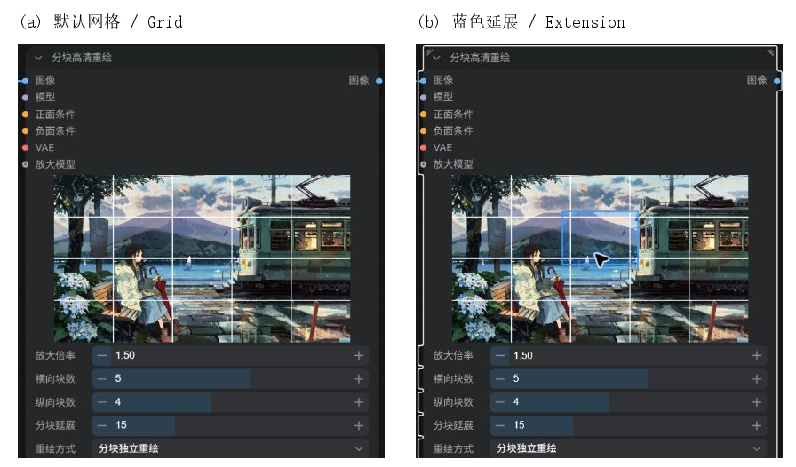
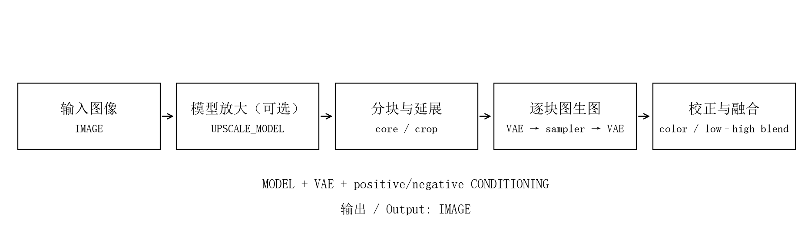

# ComfyUI Smart Tile Refine

[简体中文](README.md) · [Usage](docs/usage.md) · [How it works](docs/principles.md) · [Gallery](docs/gallery.md)

**An all-in-one ComfyUI node for tiled img2img refinement, optional model upscaling, color correction and frequency-aware blending.**

**一个节点完成分块图生图、可选模型放大、颜色校正与高低频融合，适合高分辨率插画精修。**

## In-node tile visualization



Inspect the real tile layout directly inside the main node. Change columns or rows to update the continuous white grid. Hover a tile to see its blue, boundary-clipped context region; move away to hide it. Changing extension briefly highlights the top-left tile. No image means no preview space. Preview and execution share the same coordinate planner; no generation is needed to inspect a layout.

## Install

Clone into `ComfyUI/custom_nodes`:

```sh
git clone https://github.com/Kousin-ryou/ComfyUI-SmartTileRefine.git
```

Or extract the [release ZIP](https://github.com/Kousin-ryou/ComfyUI-SmartTileRefine/releases/latest) to `custom_nodes/ComfyUI-SmartTileRefine`. Requires ComfyUI **0.41.0+**, frontend **1.55.17+** and Python **3.10+**. It reuses ComfyUI's torch, numpy, Pillow and aiohttp. Restart ComfyUI and refresh the browser. Search for **Tile Refine**.

## Connect

Provide `IMAGE`, `MODEL`, positive and negative `CONDITIONING`, and a matching `VAE`. Connect LoRAs and sampling patches upstream of `MODEL`; encode prompts with normal external text encoders. The node returns one `IMAGE`.

An optional `UPSCALE_MODEL` enables upscaling automatically. Without it, the input resolution is kept. Only the connected super-resolution model performs enlargement; its native output is reduced to the requested size. A factor of 1 still applies the connected model and returns the original resolution.



## Starting settings

| Setting | Starting point |
| --- | --- |
| Columns / rows | 2 / 2; each axis supports 1–8 |
| Tile extension | 15, interpreted as a percentage on each side |
| Redraw method | Independent tiles, or S-shaped sequence |
| Denoise | 0.20–0.30 for restrained illustration refinement |
| Color correction | Enabled, strength 0.50 |
| Tiles per pass | 1; equal padded sizes can be grouped in independent mode |
| Sampler, scheduler, steps and CFG | Follow your base model's normal settings |

The preview shows a continuous white grid. Hover a tile for its blue extension region; move away to hide it. Changing extension briefly highlights the top-left tile. No placeholder/error text is drawn; no image means no preview space. Labels follow Chinese/English settings; other languages use English.

## Examples and documentation

- [Generic workflow](examples/basic_img2img.json): select an installed checkpoint and image.
- [Krea2 workflow](examples/krea2_refine.json): the lakeside example uses Kuka LoRA at strength 1, 5×4 tiles and 8 refinement steps. Source generation uses 12 steps. The other two gallery cases use the 4-step Turbo LoRA.
- [Original demonstration gallery](docs/gallery.md): full-image before/after comparisons, fresh prompts, seeds and settings.
- [Illustrated technical explanation](docs/principles.md): exact coverage, bounded sequential context and frequency blending.
- [Compatibility and validation](docs/compatibility.md): tested environment and practical constraints.

Lower denoise first if structures drift. Set tiles per pass to 1 and increase tile counts if VRAM is tight. The total image batch is limited to 64 Mi pixels, with no separate product limit on tile count.

[MIT](LICENSE). Design references: [Ultimate SD Upscale](https://github.com/ssitu/ComfyUI_UltimateSDUpscale) and [Tiled Upscale & Refine](https://github.com/GianlucaMancuso/ComfyUI-TiledUpscale). See [third-party notices](THIRD_PARTY_NOTICES.md).
