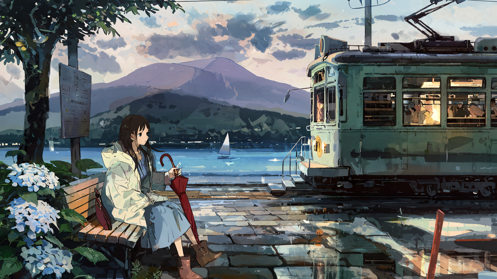
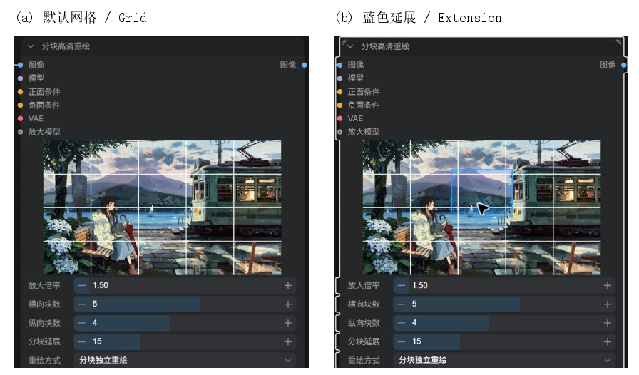
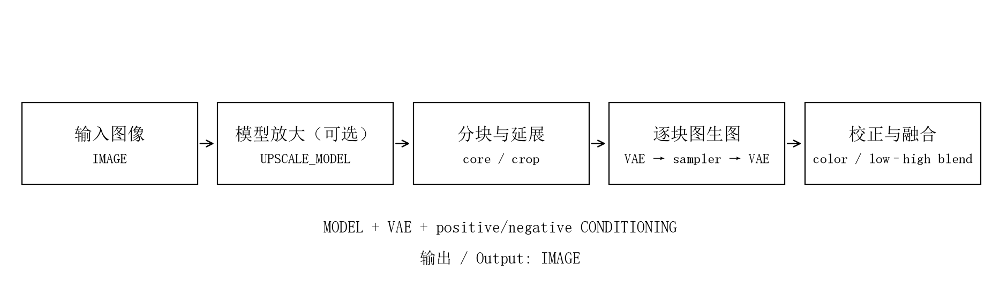
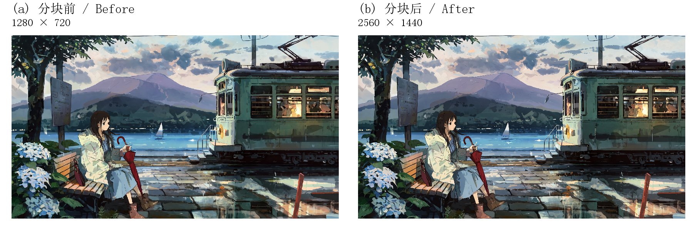
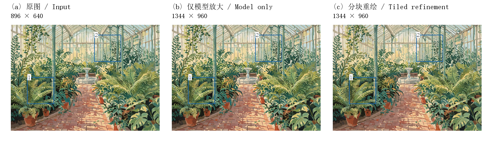
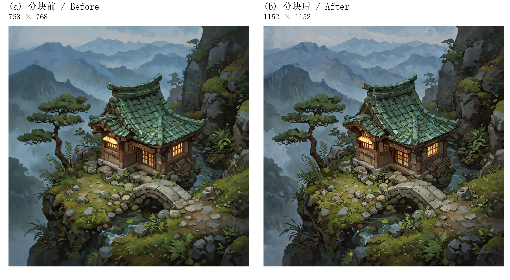
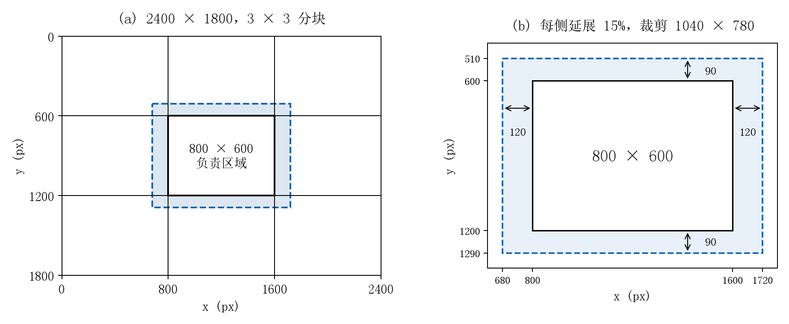
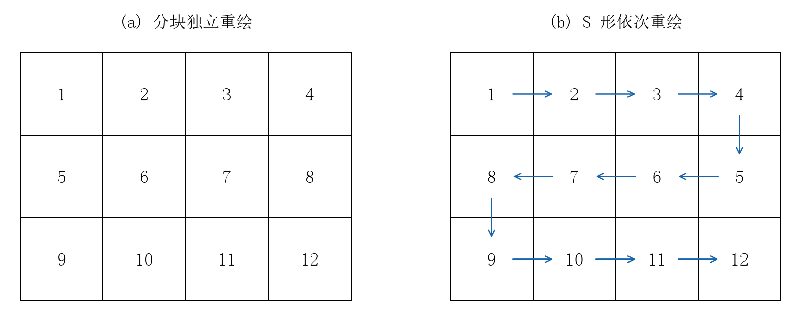
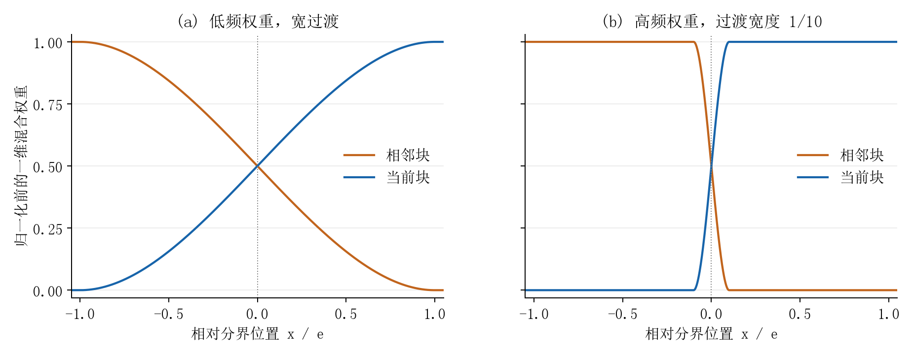

# ComfyUI Smart Tile Refine · 分块高清重绘

[English](README.en.md) · [接口](#输入与输出接口) · [完整参数](#完整参数说明) · [效果对比](#效果对比) · [处理原理](#处理原理) · [常见问题](#常见问题)

**一个节点完成分块图生图、可选模型放大、颜色校正与高低频融合，适合高分辨率插画精修。**

**An all-in-one ComfyUI node for tiled img2img refinement, optional model upscaling, color correction and frequency-aware blending.**



Kuka 风格 LoRA · 1280×720 → 2560×1440（2 倍）· 5×4 分块 · 8 步重绘。完整对照和参数见下方[效果对比](#效果对比)。

## 特点

- 普通 `MODEL / VAE / CONDITIONING` 接线，仅输出融合后的 `IMAGE`。
- 自定义横纵块数、百分比延展，整数坐标准确覆盖画布。
- 分块独立重绘或 S 形依次重绘，复用 ComfyUI 原生采样。
- 连接放大模型自动启用；未连接则保持输入尺寸。
- 节点内高清预览：连续白色网格、蓝色悬停延展，无图折叠。
- 简洁参数排布，自由调整节点大小，中英文跟随界面设置。

## 节点内可视化分块



**直接在主节点内检查分块位置和延展范围。** 上图来自实际 ComfyUI 界面，同一张横屏图使用 5×4 布局，左侧为默认状态，右侧为鼠标停留在一个图块上的状态。

- **实时网格**：修改横向、纵向块数即可更新，白色分割线连续覆盖实际图像。
- **蓝色延展**：鼠标放到某块，显示它生成时读取的实际范围；移出图片后隐藏。边缘块按图片边界裁剪。
- **调整反馈**：修改分块延展时，左上角图块短暂显示对应范围。
- **无图折叠**：没有图像时不占预览空间，不显示占位说明；图片接入后自动显示。
- **规划一致**：预览和运行共用同一套坐标规划，调整网格无需运行图像生成。

## 安装

在 `ComfyUI/custom_nodes` 中执行：

```sh
git clone https://github.com/Kousin-ryou/ComfyUI-SmartTileRefine.git
```

也可下载 [Release 安装包](https://github.com/Kousin-ryou/ComfyUI-SmartTileRefine/releases/latest)，解压成 `custom_nodes/ComfyUI-SmartTileRefine`。需要 **ComfyUI 0.41.0+、前端 1.55.17+、Python 3.10+**，使用 ComfyUI 自带的 torch、numpy、Pillow 和 aiohttp。详细步骤见[安装与更新](docs/usage.md#安装与更新)。

重启 ComfyUI、刷新网页后，搜索 **分块高清重绘**；英文界面搜索 **Tile Refine**。

## 快速上手

1. 接入图像、模型、正面条件、负面条件和匹配的 VAE。
2. 从 **2×2 分块、延展 15、重绘强度 0.20～0.30、单次数量 1** 开始。
3. 需要放大时接入 `UpscaleModelLoader`，设置放大倍率。
4. 输出接到普通预览或保存图像节点。步数、CFG、采样器按基础模型要求设置。



下载[通用接线示例](examples/basic_img2img.json)或[Krea2 示例](examples/krea2_refine.json)。导入后选择自己的模型、VAE 和输入图片；示例不包含模型文件。Krea2 两种 LoRA 的设置见[专用说明](docs/usage.md#krea2-示例)。

## 输入与输出接口

| 接口 | 类型 | 必选 | 作用与连接方式 |
| --- | --- | --- | --- |
| 图像 / Image | IMAGE | 是 | 待处理图片，可来自加载图像节点或其他 IMAGE 输出。支持 RGB/RGBA 与图片批次；输出为 RGB |
| 模型 / Model | MODEL | 是 | 当前图生图模型。LoRA、采样偏移等放在上游，处理后的 MODEL 接到这里 |
| 正面条件 / Positive | CONDITIONING | 是 | 模型对应文本编码器的正面条件。精修时用简洁的材质、线条和风格要求 |
| 负面条件 / Negative | CONDITIONING | 是 | 同一编码体系的负面条件。按模型需要填写；蒸馏模型可用空文本编码 |
| VAE | VAE | 是 | 对每个延展图块编码和解码。应与基础模型匹配，使用普通 VAE 接口 |
| 放大模型 / Upscale model | UPSCALE_MODEL | 否 | 接普通放大模型加载器，连接后自动启用整体模型放大；未连接则保持输入尺寸 |
| 图像输出 / Image | IMAGE | 输出 | 融合后的完整图片，连接普通预览或保存节点；图片批次保留相同张数 |

CLIP 和提示词都放在节点外，按现有工作流正常编码。主节点只有一个 IMAGE 输出；网格和延展标记直接显示在节点内。

## 完整参数说明

| 参数 | 范围 / 默认值 | 作用与使用注意 |
| --- | --- | --- |
| 放大倍率 / Upscale factor | 1～8 / 1.5 | 仅连接放大模型时生效。模型先按原生倍率放大，再缩小到目标画布；目标超过原生倍率时重复模型放大。倍率 1 也会先执行模型增强后恢复原尺寸 |
| 横向块数 / Columns | 1～8 / 2 | 将画布沿宽度均分为指定列数。不可整除时分配余数像素，不丢失边缘 |
| 纵向块数 / Rows | 1～8 / 2 | 将画布沿高度均分为指定行数。没有额外总块数限制，当前可选 1×1～8×8 |
| 分块延展 / Tile extension | 0～50 / 15 | 每侧按该块负责区的宽或高计算百分比延展，为采样提供周围内容。遇画布边界裁剪；数值 15 表示每侧 15% |
| 重绘方式 / Redraw method | 分块独立 / S形依次 | 独立模式各块读取共同原图；S 形逐行交替方向，有限度参考已完成区域，始终逐块执行 |
| 种子 / Seed | 0～2⁶⁴−1 / 0 | 标准 ComfyUI 种子控件，可固定、递增、递减或随机。各块噪声按稳定的行列 ID 分配 |
| 步数 / Steps | 1～10000 / 20 | 常规扩散采样步数，应遵循当前模型或 LoRA 要求 |
| CFG | 0～100 / 1 | 常规条件引导系数。部分蒸馏模型用 1，普通模型应按自身设置调整 |
| 采样器 / Sampler | ComfyUI 原生列表 | 选择采样算法，例如 Euler；沿用该模型已验证的设置 |
| 调度器 / Scheduler | ComfyUI 原生列表 | 选择噪声调度，例如 Simple；与采样器及模型设置配合 |
| 重绘强度 / Denoise | 0～1 / 0.30 | 越高越容易改变原有结构。精修可从 0.20～0.30 开始；0 时跳过扩散、颜色校正与融合，只保留可选模型放大 |
| 颜色校正 / Color correction | 开关 / 开 | 根据对应原图区修正生成块的大范围亮度与色调差 |
| 校正强度 / Correction strength | 0～1 / 0.50 | 控制低频颜色修正幅度。颜色过平可降低；只在颜色校正开启时生效 |
| 单次数量 / Tiles per pass | 1～4 / 1 | 独立模式把补齐尺寸相同的连续图块合并采样；尺寸不同会拆开。S 形模式固定逐块。此参数不增加输出图片数 |

**采样器与调度器**的实际可选项由本机 ComfyUI 提供。新建节点通常显示列表首项，工作流会保存用户选中的值。

**进度**使用一次任务的累计进度。**尺寸对齐**在内部补齐后精确裁回，不需要额外设置。

## 分块预览

- 未取得图片时不占预览空间；取得图片后显示真实网格。
- 默认只显示连续白色分割线。鼠标悬停某块时显示蓝色延展区域，移开隐藏。
- 修改分块延展时，左上角图块短暂显示延展，停止约 0.9 秒后隐藏。
- 不显示占位文字、块序号或错误提示；节点可以正常拖动调整大小。
- 已知图片来源可在运行前显示；复杂上游首次执行后同步实际图像。
- 中文界面使用中文；英文和其他语言使用英文。语言切换不改变保存的参数键。

## Krea2 使用设置

公开演示使用 Krea2 INT8、匹配的 Qwen 文本编码器与 VAE，CFG 1、Euler / Simple、AuraFlow shift 1.15。湖畔电车站使用 **Kuka 风格 LoRA 1.0，原图 12 步，分块重绘 8 步、5×4 块**；温室与茶屋使用 4 步 Turbo LoRA 和 4 步采样。不同 LoRA 的步数分开设置。

导入 [Krea2 示例](examples/krea2_refine.json)后选择自己的模型和图片。放大输入接普通 `UpscaleModelLoader`；已有外部放大图像则保持该输入断开。当前流程是正常图生图，不使用内部视觉提示词或 Edit 专用适配器。

可使用这种精修提示词，在外部正面文本编码节点填写：

```text
Preserve the existing composition, proportions and palette. Refine fine ink
contours, fabric seams and small surface textures. Keep clean restrained detail
and the same hand-painted illustration style.
```

## 效果对比

三组原图均使用本项目新编写的提示词重新生成。每组只比较分块前和分块后的完整图像，使用相同视野展示。分块后为本节点实际输出，图片未额外锐化、调色或修饰。

共同模型设置：Krea2 INT8、匹配的 Qwen 文本编码器与 VAE，CFG 1、Euler / Simple、AuraFlow shift 1.15。每组的 LoRA、放大倍率和步数分别列于下表。测试设备为 RTX 4060 Laptop 8 GB、32 GB RAM。

### 1. 雨后湖畔电车站 / Lakeside tram stop



**图 1.** 左：分块前原图；右：分块后完整输出。

[分块前 PNG](docs/assets/gallery/lakeside-source.png) · [分块后 PNG](docs/assets/gallery/lakeside-refined.png)

| 参数 | 数值 |
| --- | --- |
| 尺寸 | 1280×720 → 2560×1440 |
| 放大模型 / 倍率 | 4x-AnimeSharp / 2× |
| LoRA / 权重 | `kuka\krea2-kuka-style-v1_c1-st8000.safetensors` / 1.0 |
| 原图步数 / 重绘步数 | 12 / 8 |
| CFG / 采样 | 1 / Euler + Simple |
| 分块 / 延展 | 5×4 / 每侧 15% |
| 重绘方式 / 强度 | 分块独立重绘 / 0.25 |
| 种子 | 原图 2026111121；精修 2026111221 |
| 颜色校正 / 单次数量 | 开启 0.50 / 1 |
| 总任务耗时 | 原图 130.63 s；分块重绘 631.81 s |

<details>
<summary>提示词 / Prompts</summary>

**原图提示词**

```text
Wide landscape anime illustration, hand-painted textured brushwork, delicate clean linework. A quiet lakeside tram stop after rain in early summer. On the left foreground, a young adult woman with long dark brown hair, a cream raincoat over a muted blue dress and brown ankle boots sits sideways on a wooden bench, holding a closed red umbrella, her relaxed face in three-quarter profile looking toward the lake. On the right, one vintage mint-green tram is stopped beside the platform, warm amber light in its windows, clear perspective and simple coherent construction. Wet stone pavement reflects the tram and the pale sky. A small cluster of white hydrangeas grows beside the bench. Beyond the platform, a broad blue lake, a distant small white sailboat and layered lavender mountains under soft broken clouds. A few leafy branches frame the upper left corner. Open space over the lake in the center, distinct foreground and background, balanced cinematic composition, soft afternoon sunlight after rain, restrained teal, cream and warm gold palette, detailed environmental illustration, no writing, no lettering, no watermark.
```

**分块重绘提示词**

```text
Hand-painted anime environmental illustration, delicate clean linework, natural facial features, textured fabric, coherent tram windows and metal edges, subtle wet stone reflections, soft foliage, restrained teal cream and warm gold colors, preserve the existing composition and painted texture.
```

负面提示词为空。

</details>

[原图生成工作流（API JSON）](examples/lakeside_source_api.json) · [分块重绘工作流](examples/krea2_refine.json)

原图使用 Kuka 风格 LoRA、12 步生成；分块精修使用同一 LoRA、8 步。

### 2. 玻璃温室 / Botanical glasshouse



**图 2.** 左：分块前原图；右：分块后完整输出。

[分块前 PNG](docs/assets/gallery/glasshouse-source.png) · [分块后 PNG](docs/assets/gallery/glasshouse-refined.png)

| 参数 | 数值 |
| --- | --- |
| 尺寸 | 896×640 → 1344×960 |
| 放大模型 / 倍率 | 4x-AnimeSharp / 1.5× |
| LoRA / 权重 | `krea2\krea2_turbo_4step_rank_64_lora_comfyui.safetensors` / 1.0 |
| 原图步数 / 重绘步数 | 4 / 4 |
| CFG / 采样 | 1 / Euler + Simple |
| 分块 / 延展 | 2×2 / 每侧 15% |
| 重绘方式 / 强度 | S形依次重绘 / 0.24 |
| 种子 | 原图 2026111102；精修 2026111202 |
| 颜色校正 / 单次数量 | 开启 0.50 / 1 |
| 总任务耗时 | 原图 39.92 s；分块重绘 86.61 s |

<details>
<summary>提示词 / Prompts</summary>

**原图提示词**

```text
An original gouache and ink illustration of a quiet Victorian botanical glasshouse interior, a narrow red brick path curves between large fern beds, terracotta pots with varied leafy plants, slim green painted iron columns support tall glass panes, warm morning sunlight, soft leaf shadows on the ground, one shallow stone fountain in the distance, natural asymmetrical arrangement, no people, sage green, terracotta and creamy yellow palette, carefully drawn architectural perspective, richly varied foliage with clear shapes, matte paper texture, no lettering, no watermark.
```

**分块重绘提示词**

```text
Keep the existing architectural perspective, plant placement, palette and gouache style. Refine leaf veins, iron joints, terracotta surfaces, brick edges and subtle painted textures. Preserve broad soft lighting and avoid excessive grain.
```

负面提示词为空。

</details>

### 3. 山间茶屋 / Mountain teahouse



**图 3.** 左：分块前原图；右：分块后完整输出。

[分块前 PNG](docs/assets/gallery/teahouse-source.png) · [分块后 PNG](docs/assets/gallery/teahouse-refined.png)

| 参数 | 数值 |
| --- | --- |
| 尺寸 | 768×768 → 1152×1152 |
| 放大模型 / 倍率 | 4x-AnimeSharp / 1.5× |
| LoRA / 权重 | `krea2\krea2_turbo_4step_rank_64_lora_comfyui.safetensors` / 1.0 |
| 原图步数 / 重绘步数 | 4 / 4 |
| CFG / 采样 | 1 / Euler + Simple |
| 分块 / 延展 | 3×3 / 每侧 15% |
| 重绘方式 / 强度 | 分块独立重绘 / 0.3 |
| 种子 | 原图 2026111103；精修 2026111203 |
| 颜色校正 / 单次数量 | 开启 0.50 / 1 |
| 总任务耗时 | 原图 29.04 s；分块重绘 148.79 s |

<details>
<summary>提示词 / Prompts</summary>

**原图提示词**

```text
An original isometric fantasy illustration of a small cedar teahouse on a mossy mountain ledge, a curved green ceramic tile roof, warm amber light inside paper windows, a stone footbridge crosses a narrow stream beside the house, a wind-shaped pine tree on one side, ferns and small rounded stones, layered misty mountains far behind, dusk blue atmosphere with warm accents, a balanced square composition, clear miniature architecture, hand-painted game environment art, varied organic textures, no people, no lettering, no watermark.
```

**分块重绘提示词**

```text
Preserve the existing isometric geometry and all object positions. Refine cedar wood grain, individual ceramic roof tiles, moss, stone edges, pine needles and small water ripples. Keep the same hand-painted fantasy illustration, atmospheric blue and amber colors, clean controlled texture.
```

负面提示词为空。

</details>


## 处理原理

节点将“每块负责哪里”“生成时看到多远”“多个结果如何合成”分别处理。下面的公式与当前实现对应。

### 1. 完整处理链路


连接放大模型时，先执行非扩散式模型放大；未连接则使用输入尺寸。之后规划负责区域和延展裁剪，编码、采样、解码，进行可选颜色校正，再累计低频和高频变化，恢复完整画布。

重绘强度为 0 时，直接输出原图或模型放大结果。

### 2. 整数分割：每个像素恰好归一个块



画布为 W×H，横纵块数为 C、R：

```text
x[i] = floor(i × W / C),  i = 0 ... C
y[j] = floor(j × H / R),  j = 0 ... R
core(i,j) = [x[i], y[j], x[i+1], y[j+1])
```

区间左闭右开，最后边界恰好为 W、H。余数分散在不同块，同轴块尺寸最多相差一个像素；负责区域彼此无重叠和遗漏。

### 3. 百分比延展：上下文来自相邻画面

负责区域宽高为 w、h，延展值为 p：

```text
dx = floor(w × p / 100 + 0.5)
dy = floor(h × p / 100 + 0.5)
crop = [max(0,x0-dx), max(0,y0-dy), min(W,x1+dx), min(H,y1+dy)]
```

800×600 的块每侧延展 15%，左右各加 120，上下各加 90，理论尺寸为 1040×780。靠近图像边缘时，裁掉越界部分。每块保存绝对 core/crop 坐标，融合按原坐标回填。

延展是每一侧的百分比，不是全部重叠区的共同占比。相邻两块都可以向对方延展。

### 4. 潜空间与尺寸对齐

裁剪保留精确尺寸。送入模型前，根据 VAE 空间压缩率、模型 latent 比例与 patch 大小的公倍数补齐。补齐使用边缘复制，不移动画面原点。

VAE 编码后，由 ComfyUI 原生采样器完成普通图生图。解码结果恢复补齐尺寸，再裁去右侧和底部的补齐像素，仍对齐原画布。

### 5. S 形上下文：原图加上有限的已生成变化



独立模式只读共同原图。S 形按行交替方向，参考已完成区域的部分变化：

```text
previous = accumulated_low / low_weight + accumulated_high / high_weight
confidence = clamp(low_weight, 0, 1) × 0.5
context = clamp(source + previous × confidence, 0, 1)
```

没有生成支持的像素，confidence 为 0；已完成邻域的影响最多为 0.5。原图持续约束结构，限制前一块偏差的传播。

噪声用稳定的行列块 ID 分配，不随 S 形访问顺序重新编号；上下文仍会改变生成输入。

### 6. 颜色校正：约束宽尺度的明暗和色调

生成块为 G、原图区为 S、模糊算子为 B、强度为 a：

```text
delta = clamp(B(S) - B(G), -0.15, 0.15)
G_corrected = clamp(G + a × delta, 0, 1)
```

模糊半径随图块尺寸变化。限制差值幅度，用低频差异校正颜色，保留新生成的细线与纹理。

### 7. 高低频融合：颜色宽过渡，线条窄过渡



先分解生成图块相对于共同原图的变化 D：

```text
D = G_corrected - S
L = B(D)
H = D - L
```

L 是宽尺度颜色和光照，H 是线条与细节。低频权重过渡较宽，高频过渡约为其十分之一。

一维过渡用 `smoothstep(u) = u² × (3 - 2u)`，二维权重由横纵权重相乘。图像边缘没有相邻块时，不凭空衰减到零。最终分别归一化：

```text
output = clamp(source + sum(wL × L) / sum(wL)
                      + sum(wH × H) / sum(wH), 0, 1)
```

横向、纵向和四块交汇位置使用同一归一化过程。图块无变化时 D 为 0，精确重建原图，也是自动测试项目。

窄高频过渡减少略微错开的两条线同时平均的范围。此步骤不额外生成、不计算光流，也不对结构进行几何配准。

### 8. 内存与进度

融合在 CPU 流式累计，不保留所有完整图块。主要缓存是原图、低频累计、高频累计和两张权重图，内存随整张图片面积增长。

当前采样组完成后释放潜空间、噪声和解码临时结果。模型放大、编码、采样、解码和融合映射到同一条累计进度。


## 常见问题

- **人物变样或结构重复**：先降低重绘强度，避免每个局部提示词都要求生成整张场景。
- **显存不足**：单次数量设为 1，再增加横纵块数或减小延展。S 形模式始终逐块执行。
- **未接放大模型，倍率无效**：这是预期行为，输入会按原尺寸精修。
- **预览暂未出现**：加载图像可直接预览；复杂上游首次运行后同步实际图片。

- **颜色太平或偏色**：先降低校正强度，必要时关闭，再检查重绘强度。
- **图片透明通道**：RGBA 可作为输入，但输出为 RGB，透明通道不恢复。
- **批次与内存**：图片批次逐张处理；整批输出画布上限 64 Mi 像素、单边最多 65536，融合也占用系统内存。
- **单块尺寸**：没有 2048/3 MP 固定门槛，实际可处理大小由模型、延展和显存决定。
- **4 步设置不合适**：先确认是否接入相应 Turbo LoRA，其他模型按自身要求设置 CFG 和步数。

补充安装步骤、更新卸载和更多排错见[完整使用说明](docs/usage.md)。

## 开源

[MIT License](LICENSE) · [第三方说明](THIRD_PARTY_NOTICES.md) · [更新记录](CHANGELOG.md) · [问题反馈](https://github.com/Kousin-ryou/ComfyUI-SmartTileRefine/issues)

设计参考：[Ultimate SD Upscale](https://github.com/ssitu/ComfyUI_UltimateSDUpscale) 与 [Tiled Upscale & Refine](https://github.com/GianlucaMancuso/ComfyUI-TiledUpscale)。
