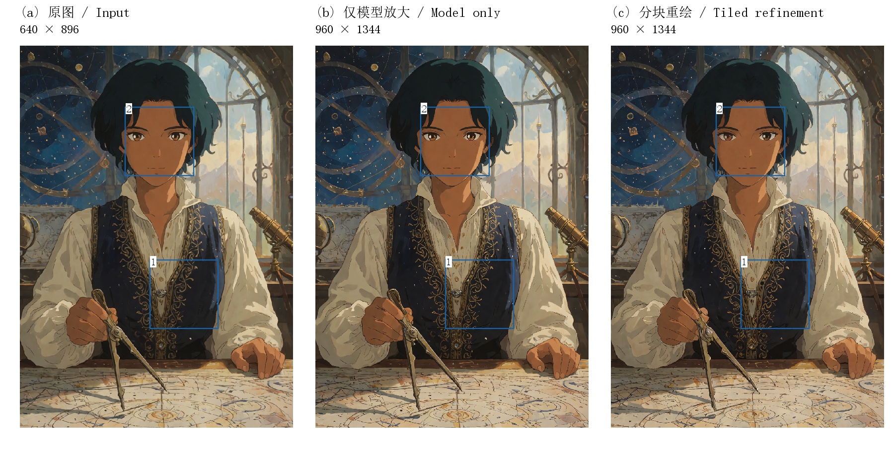
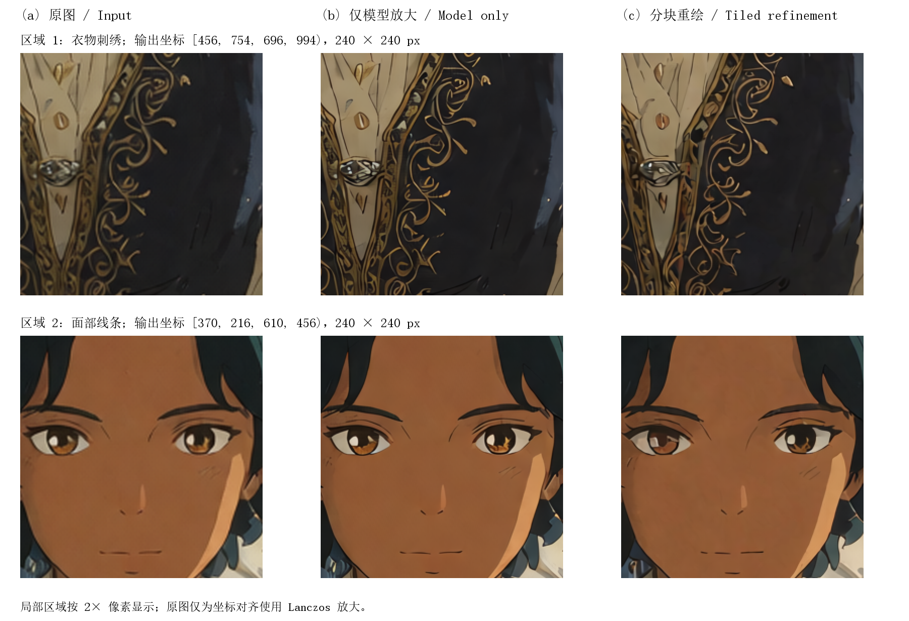
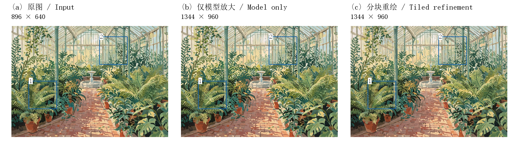
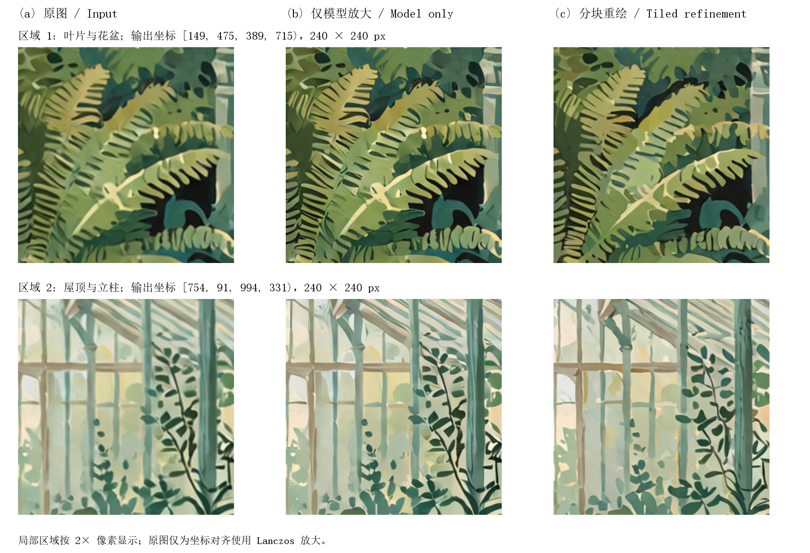
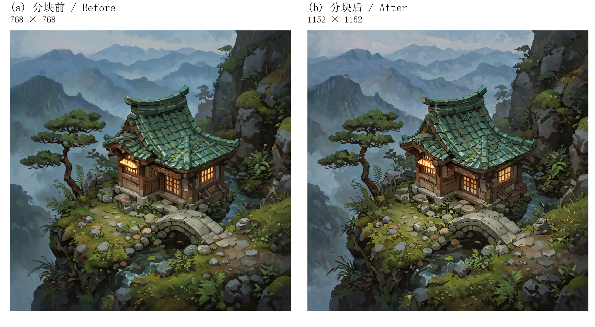
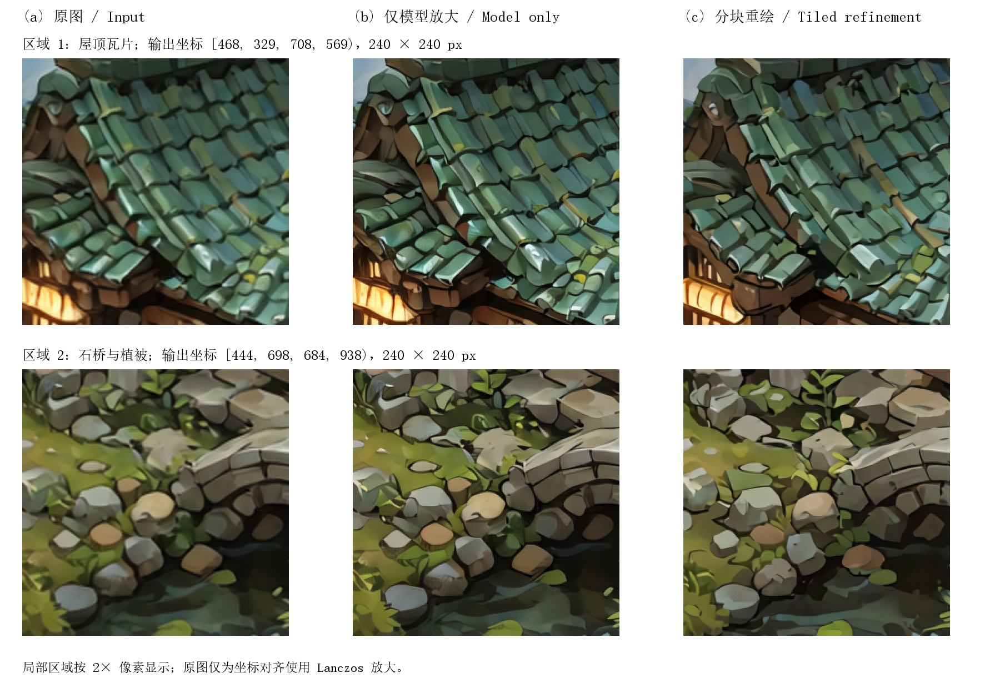

# 效果对比

[返回首页](../README.md) · [使用说明](usage.md) · [参数与坐标 JSON](assets/gallery/parameters.json)

三组原图均使用本项目新编写的提示词重新生成。每组比较三个条件：

- **(a) 原图**：Krea2 文生图输出。
- **(b) 仅模型放大**：4x-AnimeSharp，目标倍率 1.5，重绘强度 0。
- **(c) 分块重绘**：相同放大模型与倍率，再执行本节点的局部图生图、颜色校正和融合。

所有列使用相同视野。局部图取相同输出坐标，以 2× 像素显示；原图仅为坐标对齐做 Lanczos 放大。图中蓝框和编号标出局部位置，图片未额外锐化、调色或修饰。

共同模型设置：Krea2 INT8＋4 步 Turbo LoRA，4 steps、CFG 1、Euler / Simple、AuraFlow shift 1.15。测试设备为 RTX 4060 Laptop 8 GB、32 GB RAM。

## 1. 日光下的星图师 / Sunlit cartographer



**图 1a.** (a) 原图；(b) 仅模型放大；(c) 分块重绘。蓝框 1、2 对应下一幅局部图。



**图 1b.** 相同坐标的两个局部区域，比较轮廓、纹理与颜色变化。

[原图 PNG](assets/gallery/cartographer-source.png) · [模型放大 PNG](assets/gallery/cartographer-model-only.png) · [分块重绘 PNG](assets/gallery/cartographer-refined.png)

| 参数 | 数值 |
| --- | --- |
| 尺寸 | 640×896 → 960×1344 |
| 分块 / 延展 | 2×2 / 每侧 15% |
| 重绘方式 / 强度 | 分块独立重绘 / 0.2 |
| 种子 | 原图 2026111101；精修 2026111201 |
| 颜色校正 / 单次数量 | 开启 0.50 / 1 |
| 总任务耗时 | 原图 120.04 s；分块重绘 135.42 s |

<details>
<summary>提示词 / Prompts</summary>

**原图提示词**

```text
An original hand-painted anime illustration of an adult female celestial cartographer in a sunlit observatory, waist-up portrait, warm brown skin, short dark teal hair, amber eyes, ivory linen shirt under a navy embroidered vest, one hand gently holding a brass drafting compass above a wooden desk, celestial charts and a small brass telescope in the background, warm sunlight through a tall arched window, deep blue and muted gold palette, delicate fabric embroidery, clear elegant linework, restrained painterly shading, coherent anatomy, one person, no lettering, no watermark.
```

**分块重绘提示词**

```text
Preserve the existing illustration, composition, anatomy and colors. Refine fine ink contours, fabric weave, embroidered seams, small brass engravings and painted surface texture. Restrained clean detail, soft natural light, consistent hand-painted anime finish.
```

负面提示词为空。

</details>

## 2. 玻璃温室 / Botanical glasshouse



**图 2a.** (a) 原图；(b) 仅模型放大；(c) 分块重绘。蓝框 1、2 对应下一幅局部图。



**图 2b.** 相同坐标的两个局部区域，比较轮廓、纹理与颜色变化。

[原图 PNG](assets/gallery/glasshouse-source.png) · [模型放大 PNG](assets/gallery/glasshouse-model-only.png) · [分块重绘 PNG](assets/gallery/glasshouse-refined.png)

| 参数 | 数值 |
| --- | --- |
| 尺寸 | 896×640 → 1344×960 |
| 分块 / 延展 | 2×2 / 每侧 15% |
| 重绘方式 / 强度 | S形依次重绘 / 0.24 |
| 种子 | 原图 2026111102；精修 2026111202 |
| 颜色校正 / 单次数量 | 开启 0.50 / 1 |
| 总任务耗时 | 原图 39.92 s；分块重绘 86.61 s |

<details>
<summary>提示词 / Prompts</summary>

**原图提示词**

```text
An original gouache and ink illustration of a quiet Victorian botanical glasshouse interior, a narrow red brick path curves between large fern beds, terracotta pots with varied leafy plants, slim green painted iron columns support tall glass panes, warm morning sunlight, soft leaf shadows on the ground, one shallow stone fountain in the distance, natural asymmetrical arrangement, no people, sage green, terracotta and creamy yellow palette, carefully drawn architectural perspective, richly varied foliage with clear shapes, matte paper texture, no lettering, no watermark.
```

**分块重绘提示词**

```text
Keep the existing architectural perspective, plant placement, palette and gouache style. Refine leaf veins, iron joints, terracotta surfaces, brick edges and subtle painted textures. Preserve broad soft lighting and avoid excessive grain.
```

负面提示词为空。

</details>

## 3. 山间茶屋 / Mountain teahouse



**图 3a.** (a) 原图；(b) 仅模型放大；(c) 分块重绘。蓝框 1、2 对应下一幅局部图。



**图 3b.** 相同坐标的两个局部区域，比较轮廓、纹理与颜色变化。

[原图 PNG](assets/gallery/teahouse-source.png) · [模型放大 PNG](assets/gallery/teahouse-model-only.png) · [分块重绘 PNG](assets/gallery/teahouse-refined.png)

| 参数 | 数值 |
| --- | --- |
| 尺寸 | 768×768 → 1152×1152 |
| 分块 / 延展 | 3×3 / 每侧 15% |
| 重绘方式 / 强度 | 分块独立重绘 / 0.3 |
| 种子 | 原图 2026111103；精修 2026111203 |
| 颜色校正 / 单次数量 | 开启 0.50 / 1 |
| 总任务耗时 | 原图 29.04 s；分块重绘 148.79 s |

<details>
<summary>提示词 / Prompts</summary>

**原图提示词**

```text
An original isometric fantasy illustration of a small cedar teahouse on a mossy mountain ledge, a curved green ceramic tile roof, warm amber light inside paper windows, a stone footbridge crosses a narrow stream beside the house, a wind-shaped pine tree on one side, ferns and small rounded stones, layered misty mountains far behind, dusk blue atmosphere with warm accents, a balanced square composition, clear miniature architecture, hand-painted game environment art, varied organic textures, no people, no lettering, no watermark.
```

**分块重绘提示词**

```text
Preserve the existing isometric geometry and all object positions. Refine cedar wood grain, individual ceramic roof tiles, moss, stone edges, pine needles and small water ripples. Keep the same hand-painted fantasy illustration, atmospheric blue and amber colors, clean controlled texture.
```

负面提示词为空。

</details>

## 复现步骤

1. 下载对应原图，通过 ComfyUI 加载图像节点上传。
2. 导入 [Krea2 接线示例](../examples/krea2_refine.json)，选择相同模型、4 步 LoRA、文本编码器和 VAE。
3. 外部正面文本编码节点填入本页的分块重绘提示词，负面留空。
4. 设置表中的分块、延展、重绘强度和精修种子，连接 4x-AnimeSharp，倍率 1.5。
5. 将重绘强度设为 0，可取得仅模型放大的对照。

总任务时间包含模型加载与缓存影响。模型、LoRA、软件版本或设备变化会影响固定种子的生成细节。

English: panels (a), (b), (c) are newly generated input, model-only upscale, and tiled refinement. The two detail rows use the same output coordinates and a 2x display. Prompts, seeds and complete settings are included.
