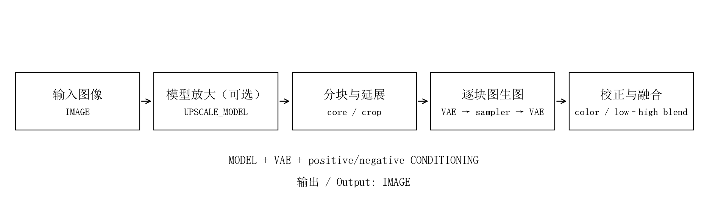
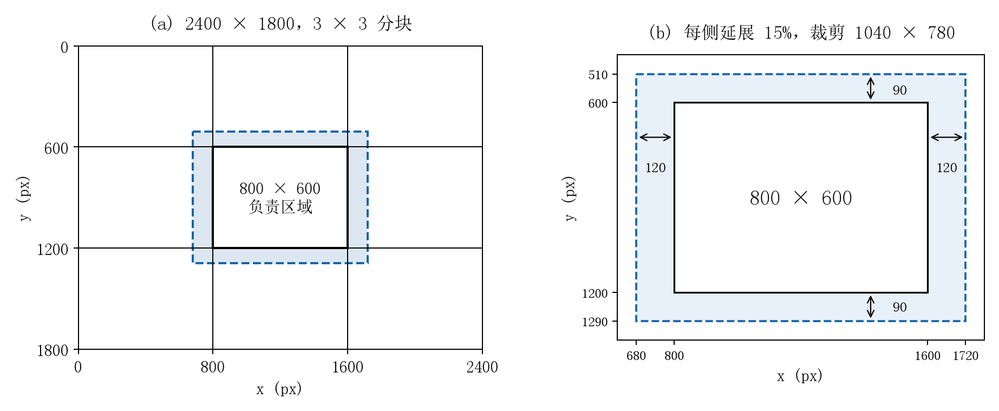
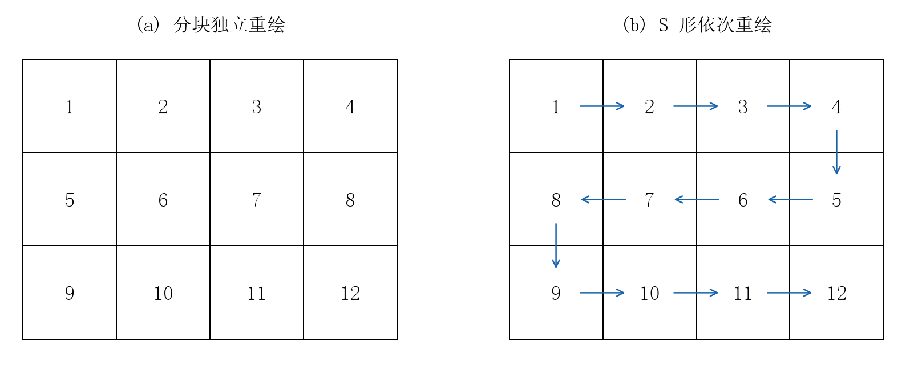
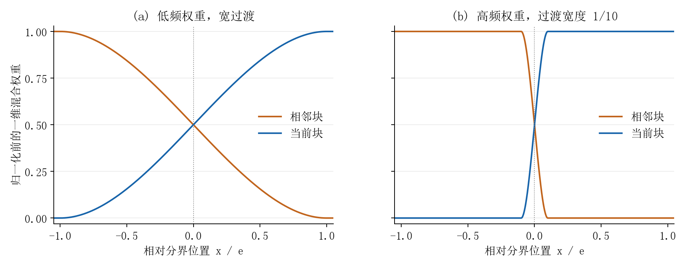

# 原理图解 · How it works

[返回首页](../README.md) · [使用说明](usage.md)

节点将“每块负责哪里”“生成时看到多远”“多个结果如何合成”分别处理。下面的公式与当前实现对应。

## 1. 完整处理链路



连接放大模型时，先执行非扩散式模型放大；未连接则使用输入尺寸。之后规划负责区域和延展裁剪，编码、采样、解码，进行可选颜色校正，再累计低频和高频变化，恢复完整画布。

重绘强度为 0 时，直接输出原图或模型放大结果。

## 2. 整数分割：每个像素恰好归一个块



画布为 W×H，横纵块数为 C、R：

```text
x[i] = floor(i × W / C),  i = 0 ... C
y[j] = floor(j × H / R),  j = 0 ... R
core(i,j) = [x[i], y[j], x[i+1], y[j+1])
```

区间左闭右开，最后边界恰好为 W、H。余数分散在不同块，同轴块尺寸最多相差一个像素；负责区域彼此无重叠和遗漏。

## 3. 百分比延展：上下文来自相邻画面

负责区域宽高为 w、h，延展值为 p：

```text
dx = floor(w × p / 100 + 0.5)
dy = floor(h × p / 100 + 0.5)
crop = [max(0,x0-dx), max(0,y0-dy), min(W,x1+dx), min(H,y1+dy)]
```

800×600 的块每侧延展 15%，左右各加 120，上下各加 90，理论尺寸为 1040×780。靠近图像边缘时，裁掉越界部分。每块保存绝对 core/crop 坐标，融合按原坐标回填。

延展是每一侧的百分比，不是全部重叠区的共同占比。相邻两块都可以向对方延展。

## 4. 潜空间与尺寸对齐

裁剪保留精确尺寸。送入模型前，根据 VAE 空间压缩率、模型 latent 比例与 patch 大小的公倍数补齐。补齐使用边缘复制，不移动画面原点。

VAE 编码后，由 ComfyUI 原生采样器完成普通图生图。解码结果恢复补齐尺寸，再裁去右侧和底部的补齐像素，仍对齐原画布。

## 5. S 形上下文：原图加上有限的已生成变化



独立模式只读共同原图。S 形按行交替方向，参考已完成区域的部分变化：

```text
previous = accumulated_low / low_weight + accumulated_high / high_weight
confidence = clamp(low_weight, 0, 1) × 0.5
context = clamp(source + previous × confidence, 0, 1)
```

没有生成支持的像素，confidence 为 0；已完成邻域的影响最多为 0.5。原图持续约束结构，限制前一块偏差的传播。

噪声用稳定的行列块 ID 分配，不随 S 形访问顺序重新编号；上下文仍会改变生成输入。

## 6. 颜色校正：约束宽尺度的明暗和色调

生成块为 G、原图区为 S、模糊算子为 B、强度为 a：

```text
delta = clamp(B(S) - B(G), -0.15, 0.15)
G_corrected = clamp(G + a × delta, 0, 1)
```

模糊半径随图块尺寸变化。限制差值幅度，用低频差异校正颜色，保留新生成的细线与纹理。

## 7. 高低频融合：颜色宽过渡，线条窄过渡



先分解生成图块相对于共同原图的变化 D：

```text
D = G_corrected - S
L = B(D)
H = D - L
```

L 是宽尺度颜色和光照，H 是线条与细节。低频权重过渡较宽，高频过渡约为其十分之一。

一维过渡用 `smoothstep(u) = u² × (3 - 2u)`，二维权重由横纵权重相乘。图像边缘没有相邻块时，不凭空衰减到零。最终分别归一化：

```text
output = clamp(source + sum(wL × L) / sum(wL)
                      + sum(wH × H) / sum(wH), 0, 1)
```

横向、纵向和四块交汇位置使用同一归一化过程。图块无变化时 D 为 0，精确重建原图，也是自动测试项目。

窄高频过渡减少略微错开的两条线同时平均的范围。此步骤不额外生成、不计算光流，也不对结构进行几何配准。

## 8. 内存与进度

融合在 CPU 流式累计，不保留所有完整图块。主要缓存是原图、低频累计、高频累计和两张权重图，内存随整张图片面积增长。

当前采样组完成后释放潜空间、噪声和解码临时结果。模型放大、编码、采样、解码和融合映射到同一条累计进度。

## 源码对应

| 逻辑 | 文件 |
| --- | --- |
| 分割、延展、目标尺寸 | [`geometry.py`](../geometry.py) |
| VAE、原生采样、模型放大、进度 | [`nodes.py`](../nodes.py) |
| 低通、颜色、权重、流式融合 | [`image_ops.py`](../image_ops.py) |
| 预览、悬停、语言、异步状态 | [`web/smart_tile_final.js`](../web/smart_tile_final.js) |

元数据和前端组织参考 [ComfyUI 元数据规范](https://docs.comfy.org/registry/specifications)与[前端扩展钩子](https://docs.comfy.org/zh-CN/custom-nodes/js/javascript_hooks)。
