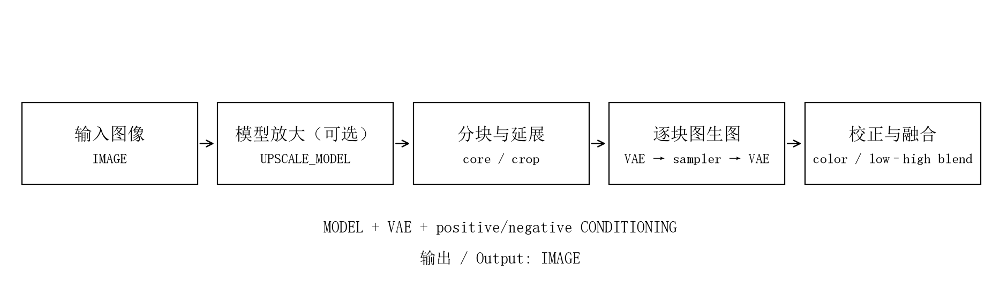
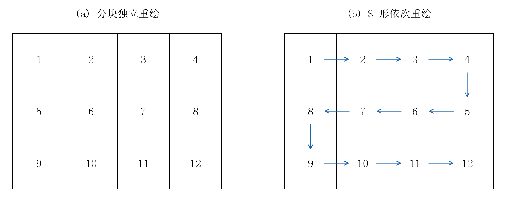

# 使用说明

[返回首页](../README.md) · [原理图解](principles.md) · [效果展示](gallery.md)

## 安装与更新

### Git 安装

打开 `ComfyUI/custom_nodes`，执行：

```sh
git clone https://github.com/Kousin-ryou/ComfyUI-SmartTileRefine.git
```

在启动 ComfyUI 的同一个 Python 环境中安装前端版本要求：

```sh
python -m pip install -r ComfyUI-SmartTileRefine/requirements.txt
```

便携版使用便携包自己的 Python；Desktop 使用它管理的环境。torch、numpy、Pillow 和 aiohttp 由正常 ComfyUI 环境提供，不另外替换它们。安装后重启服务并刷新页面，搜索“分块高清重绘”或“Tile Refine”，分类为 `image/Smart Tile Refine`。

### ZIP 安装

从 [Releases](https://github.com/Kousin-ryou/ComfyUI-SmartTileRefine/releases/latest) 下载安装包，解压后确认：

```text
ComfyUI/custom_nodes/ComfyUI-SmartTileRefine/
├─ __init__.py
├─ nodes.py
├─ web/
└─ locales/
```

`__init__.py` 不应多套一层目录。替换安装时关闭服务，移走旧的同名节点目录，避免同时加载两份。模型保留在 ComfyUI 的模型目录。

### 更新与卸载

Git 安装在节点目录执行 `git pull`，安装 `requirements.txt`、重启服务、刷新网页。ZIP 安装用新版本完整替换同名节点目录。卸载只需移除该节点目录。

## 基础接线



| 接口 | 连接方式 |
| --- | --- |
| 图像 / Image | `LoadImage`，或工作流的 IMAGE 输出 |
| 模型 / Model | 模型加载器；LoRA、模型采样设置留在上游 |
| 正面条件 / Positive | 模型对应的文本编码节点输出 |
| 负面条件 / Negative | 相同编码器的负面条件；蒸馏模型可编码空文本 |
| VAE | 与模型匹配的 VAE |
| 放大模型 / Upscale model | 可选，普通 `UpscaleModelLoader` 输出 |
| 图像输出 | 普通预览或保存图像节点 |

本节点不接 CLIP，提示词在外部正常编码。图生图使用当前扩展图块的 VAE 编码作为采样起点。

## 第一次运行

1. 导入[通用示例](../examples/basic_img2img.json)，选择自己的 checkpoint 和图片。
2. 提示词写简洁的材质、线条、光照或画风要求。
3. 设置横向 2、纵向 2、分块延展 15、分块独立重绘、单次数量 1。
4. 重绘强度先用 0.20～0.30，其他采样参数沿用该模型正常设置。
5. 先看整体构图，再放大观察人物边缘、衣褶和跨块结构。

默认步数 20、CFG 1 只是初始值。普通非蒸馏模型应按各自要求调整步数和 CFG。

## 完整参数

| 中文 / English | 范围或默认值 | 实际行为 |
| --- | --- | --- |
| 放大倍率 / Upscale factor | 1～8，默认 1.5 | 接放大模型才生效；未接保持原尺寸。倍率 1 仍经模型增强后恢复原尺寸 |
| 横向块数 / Columns | 1～8，默认 2 | 沿宽度均分为多少列 |
| 纵向块数 / Rows | 1～8，默认 2 | 沿高度均分为多少行；无额外总块数限制 |
| 分块延展 / Tile extension | 0～50，默认 15 | 每侧按负责区域宽高的百分比延展，遇边界裁剪 |
| 重绘方式 / Redraw method | 分块独立 / S 形依次 | 独立读取原图；S 形有限度参考已完成区域 |
| 种子 / Seed | 标准种子控件 | 固定、递增、递减、随机；块噪声按稳定行列 ID 分配 |
| 步数 / Steps | 默认 20 | 普通采样步数 |
| CFG | 默认 1 | 普通引导系数，按基础模型要求设置 |
| 采样器 / Sampler | 原生列表 | 例如 Euler，按模型设置 |
| 调度器 / Scheduler | 原生列表 | 例如 Simple，按模型设置 |
| 重绘强度 / Denoise | 0～1，默认 0.30 | 越高越容易重建结构；0 时跳过扩散、颜色校正与融合 |
| 颜色校正 / Color correction | 默认开启 | 用对应原图区约束宽尺度亮度和色调 |
| 校正强度 / Correction strength | 0～1，默认 0.50 | 越高越贴近原图低频颜色 |
| 单次数量 / Tiles per pass | 1～4，默认 1 | 独立模式合并补齐尺寸相同的连续图块；S 形始终逐块执行 |

“单次数量”是一次采样处理的图块数，不是输出图片数，也不是队列执行次数。不同补齐尺寸的图块会拆开执行。

## 放大模型

连接 `UpscaleModelLoader` 自动启用。模型原生倍率高于目标倍率时，先由模型放大再缩小到目标画布；目标高于原生倍率时重复模型放大。放大阶段的内部分块计算汇入同一条累计进度。

外部已放大的图片，直接接入 IMAGE 并保持放大模型断开。内部放大时，选择适合原图照片或插画风格的模型。

## 两种重绘方式



**分块独立重绘**每块锚定同一个原图，形状相同的连续图块可以合并采样。

**S形依次重绘**第一行左到右、第二行右到左交替处理。新块有限度地读取先前生成过的区域，延续跨块颜色和线条；原图始终作为共同基底。

顺序模式改变了图像上下文，即使种子相同也会有不同细节。固定其他参数再比较当前图片的两种结果。

## 预览与语言

顶部只显示图片、白色分割线及需要时的蓝色延展标记。悬停某块显示延展，移开隐藏；调整延展时短暂显示左上角图块，停止约 0.9 秒后隐藏。预览不显示占位文字或错误说明。

`LoadImage`、可追溯的重路由和常见尺寸调整可在运行前预览。未知上游首次执行后同步实际图像；运行前预览主要反映可追溯图片和尺寸，不执行生成。实际运行使用后端规划，并同步真实像素。

界面名称、接口、参数和重绘选项跟随语言设置；中文用中文，其他语言用英文。切换语言不改变保存的参数键与重绘枚举值。

## Krea2 示例

[Krea2 工作流](../examples/krea2_refine.json)使用独立的 diffusion model、文本编码器和 VAE。选择自己的已安装文件，文本编码器类型为 `krea2`，VAE 与模型匹配。

公开演示采用 Krea2 INT8、4 步 Turbo LoRA、AuraFlow shift 1.15、Euler / Simple、4 步、CFG 1。**4 步设置依赖相应 LoRA**；不用该 LoRA 时按原模型要求设置。

本节点走普通图生图，不注入逐块 ReferenceLatent，不调用 Edit 适配器，不在内部进行视觉文本编码。

可用这种简短精修提示词：

```text
Preserve the existing composition, proportions and palette. Refine fine ink
contours, fabric seams and small surface textures. Keep clean restrained detail
and the same hand-painted illustration style.
```

若每个小块都被要求生成“一个完整人物、一座完整房屋”，高重绘强度下更容易出现重复结构。先使用低强度，并让单块容纳主要对象。

## 常见问题

### 搜不到节点

查看启动日志是否有导入错误，检查多套目录或重复安装。确认版本要求，重启服务并刷新网页。

### 预览未显示或仍看到旧界面

确认 IMAGE 接通，上游有可读取图片；复杂上游先执行一次。更新后强制刷新页面，图片权限和文件问题可在浏览器开发者工具中排查。

### 接缝、重影、人物变化

先降低重绘强度，适度增加延展，试用 S 形模式。相邻块生成了不同结构时，融合处理的是已有像素。延展为 0 时没有额外跨块过渡带。

### 显存不足或速度慢

单次数量设为 1，再增加块数或减小延展。延展增加采样像素量；分块过密增加 VAE 和模型调用次数。单块没有 2048/3 MP 固定门槛，可用尺寸取决于显存和模型。

### 颜色太平或偏色

降低校正强度，必要时关闭；再降低重绘强度。校正主要约束低频颜色，强风格化或光照重建会改变原图色调。

### 图像批次、透明度与尺寸

支持 IMAGE 批次，逐张处理并保持批次数量。预览显示当前处理图像。RGB/RGBA 均可接入，输出为 RGB，透明通道不参与生成或恢复。

整批画布上限为 `64 × 1024 × 1024` 像素、单边最多 65536；放大模型中间画布另有限制。大画布融合也会占用系统内存。

## English quick reference

Install into `custom_nodes`, restart, refresh and search **Tile Refine**. Connect image, model, positive/negative conditioning and a matching VAE. Add an optional upscale model to enable enlargement. Start with 2×2 tiles, extension 15, denoise 0.20–0.30 and tiles per pass 1. Follow your base model's sampler/steps/CFG requirements. The 4-step Krea2 example requires the matching Turbo LoRA.
